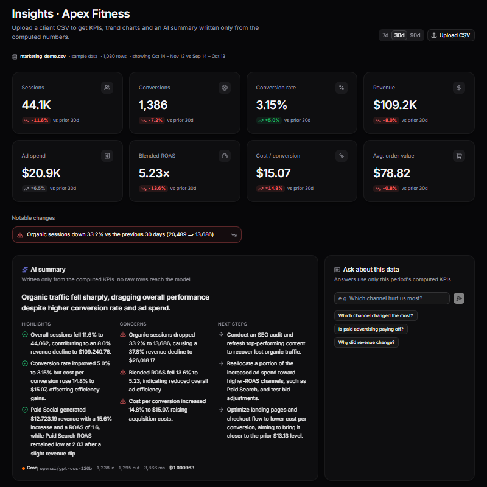
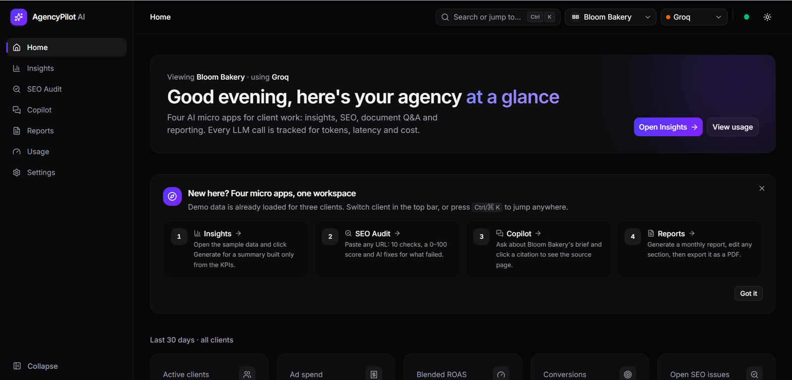
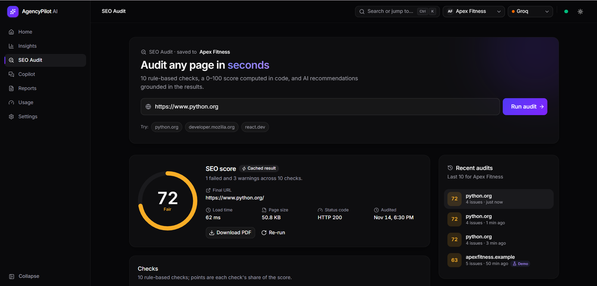
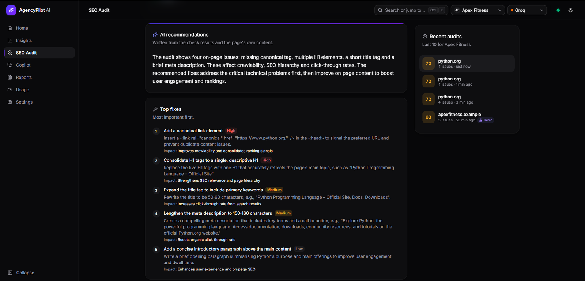
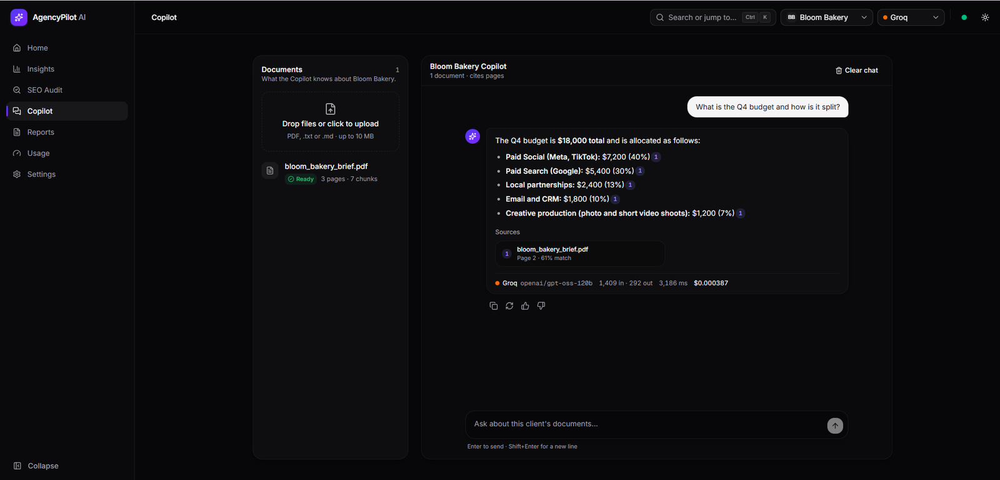
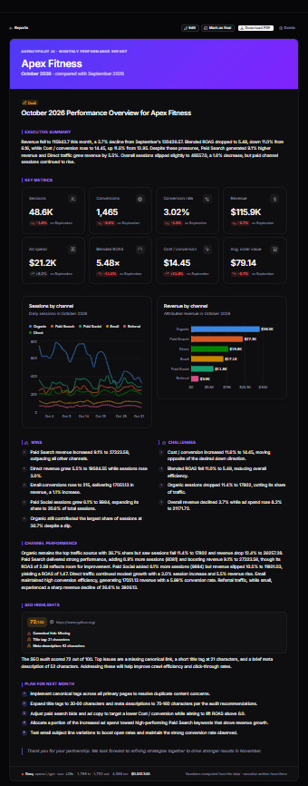
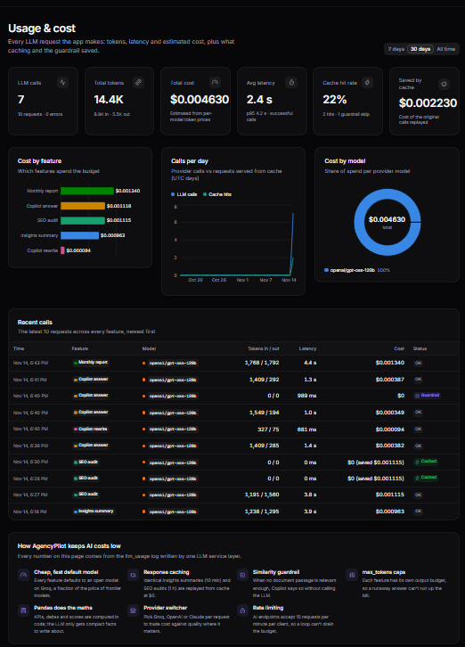
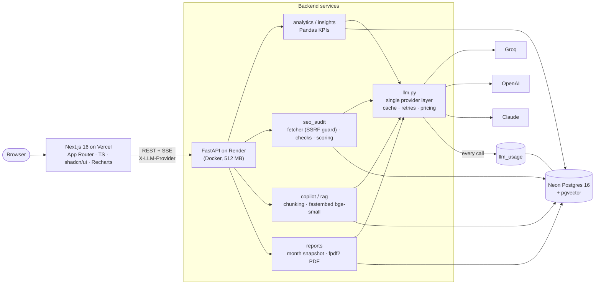

# AgencyPilot AI

**An AI workspace for digital agencies:** client analytics, SEO audits, a RAG copilot over client
documents and monthly reports, with every LLM call tracked for tokens, latency and cost.

[](https://github.com/SamarthML/agencypilot-ai/actions/workflows/ci.yml)


[](LICENSE)

## Live demo

| | |
|---|---|
| **App** | <https://agencypilot-ai-three.vercel.app> |
| **API docs** | <https://agencypilot-ai-k883.onrender.com/docs> |

> Free hosting: the first load can take **~30-60 s** while the backend wakes up (a banner shows
> progress). The demo runs on **Groq** with three seeded demo clients (Apex Fitness, Bloom Bakery,
> Nova Dental), so every page has data from the start.



| | |
|---|---|
|  **Home**: agency KPIs and onboarding |  **SEO Audit**: score gauge and fetch facts |
|  **SEO Audit**: prioritised AI fixes |  **Copilot**: streamed answer with page citation |
|  **Report**: editable monthly report, PDF export |  **Usage**: cost, latency, cache savings per call |

## Why I built this

Agencies spend hours every month turning client data into the same deliverables: "what changed
and why", SEO fixes, answers buried in client briefs, and a monthly report. Those tasks suit LLMs
well, as long as the model is **grounded in real numbers and documents** and its **cost is
visible**. AgencyPilot is my take on that: four small AI tools that share one LLM layer, one usage
log and one Postgres database, built the way I'd build them for production.

## Features

| Micro app | What it does |
|---|---|
| **Client Insights** | CSV upload → Pandas KPIs (sessions, CVR, revenue, ROAS, CPA, AOV, period-over-period deltas, channel breakdown, notable-change signals) → Recharts charts → AI summary and Q&A written **only from the computed KPI JSON**. The raw CSV never reaches the LLM. |
| **SEO Audit** | URL → SSRF-guarded fetch → 10 rule-based checks → weighted 0-100 score computed in code → AI report (5 prioritised fixes, rewritten title/meta, keywords, content ideas) from the failed checks. Audit history per client, print-to-PDF. |
| **Client Copilot** | Upload PDF/TXT/MD → token-aware chunking → `bge-small-en-v1.5` embeddings in pgvector (HNSW) → follow-up rewrite → retrieval → similarity guardrail → **streamed** answer (SSE) with clickable page citations. Thumbs feedback is stored. |
| **Report Generator** | Pick a month → calendar-month KPIs vs the previous month, top movers and the latest SEO audit → grounded narrative (validated JSON) → edit every section in the browser → mark final → A4 PDF export. |
| **Model switcher** | Groq (default), OpenAI or Claude per request via the `X-LLM-Provider` header; unavailable providers are disabled. |
| **Usage & cost** | Every call logged: feature, provider, model, tokens in/out, latency, cost, cached/skipped. Dashboard with totals, p95 latency, cache hit rate and money saved by the cache. |

Also: Ctrl/⌘+K command palette, dark/light themes, responsive down to 375 px, WCAG AA contrast.

## Architecture



`services/llm.py` is the only module that talks to a provider. Routes stay thin; business logic
lives in `services/` and is unit-tested without HTTP.

## Tech stack

| Layer | Tools |
|---|---|
| Frontend | Next.js 16 (App Router, Cache Components) · React 19 · TypeScript strict · Tailwind CSS · shadcn/ui · Recharts · Framer Motion · lucide-react |
| Backend | Python 3.12 · FastAPI · Pydantic v2 + pydantic-settings · SQLAlchemy 2 · Alembic · Pandas · httpx · BeautifulSoup4 · pypdf · fpdf2 |
| AI / RAG | Groq (`openai/gpt-oss-120b`) · OpenAI (`gpt-4o-mini`) · Anthropic Claude · `BAAI/bge-small-en-v1.5` (384-dim) via sentence-transformers (dev) or fastembed/ONNX (prod) |
| Data | PostgreSQL 16 + pgvector (HNSW cosine index) |
| Infra | Docker Compose · GitHub Actions · Vercel · Render · Neon |
| Testing | pytest + pytest-cov · ruff · vitest · ESLint |

## Key engineering decisions

**1. Numbers come from Pandas, never from the LLM.** KPIs, deltas, channel breakdowns and signals
are computed in `analytics.py`. The model receives only that compact JSON, and the prompt forbids
inventing figures. Reports use the same rule: calendar-month metrics plus the latest SEO audit, no
daily rows. A test asserts that no raw rows appear in the prompt.

**2. The SEO score is rule-based; the LLM only explains it.** Ten pure-function checks
(pass 1 / warn 0.5 / fail 0, weighted) produce a reproducible 0-100 score. The LLM gets the failed
checks plus the title, meta and first 1,500 characters of text. If it fails, the audit still returns
with `ai: null`. The fetcher is an **SSRF guard**: http/https on default ports only, every resolved
IP must be public (private, loopback, link-local, CGNAT, multicast, IPv4-mapped and NAT64 blocked),
re-checked on each of up to 5 manually followed redirects, and the connection is pinned to the
validated IP (Host header + TLS SNI) to stop DNS rebinding. 10 s timeout, 2 MB cap.
([screenshot](docs/screenshots/seo-ssrf.png))

**3. Chunk size chosen by measurement.** On the sample brief, whole-page chunks (~450 tokens) put
the right page on top for **4/10** test questions; **250-token** chunks (40-token overlap) did it for
**8/10** and separated off-topic questions far better. Smaller chunks gained nothing. Chunks are
measured with the embedding model's own tokenizer, and over-limit text raises instead of being
silently truncated.

**4. Similarity threshold calibrated on real scores.** With bge-small, in-document questions scored
**≥ 0.52** and unrelated ones **0.36-0.50**, so `COPILOT_MIN_SIMILARITY = 0.5`. Below it the Copilot
answers "couldn't find this" **without an LLM call** (logged as `skipped`, $0).
([screenshot](docs/screenshots/copilot-guardrail.png))

**5. One provider abstraction.** Groq, OpenAI and Claude sit behind `generate()` / `stream()` /
`generate_structured()` with shared retry/backoff, Pydantic-validated JSON output with one repair
retry, and per-feature `max_tokens` caps. Costs come from one price table (`pricing.py`). Provider
SDKs are imported lazily (the Anthropic SDK alone is ~37 MB resident).

**6. Caching with the savings measured.** Insights summaries (10 min) and SEO audits (1 h per
normalised URL + provider) are TTL-cached. A cache hit is logged with cost $0 and `saved_cost_usd`
(the original call's cost), so the Usage page shows real money saved. The live-demo snapshot above:
10 requests, 22% cache hit rate, $0.004630 spent, $0.002230 saved.

**7. Streaming over SSE.** Copilot answers stream as `token` → `citations` → `done` (or `error`)
events. The frontend parses them with a small pure parser (unit-tested), supports stop/regenerate,
and the backend logs tokens and cost when the stream completes.

**8. Rate limiting that survives a proxy.** A per-IP sliding window guards every LLM route (20/min,
10/min in demo mode, 429 + `Retry-After`). Behind Render's proxy the client IP is the
`X-Forwarded-For` entry `TRUSTED_PROXY_COUNT` hops from the right, so values a client types into
the header are ignored (covered by spoofed-header tests). A request-wide body cap returns 413
before multipart buffering.

**9. Fitting RAG into 512 MB.** Render's free tier has 512 MB of RAM, too little for torch. In
production the same bge-small model runs on **fastembed/ONNX** (cosine **≥ 0.9999** vs
sentence-transformers). Two measured fixes: the ONNX CPU memory arena is **off** (it kept +170 MB
per batch and never returned it) and the batch size is **8** (a batch of 32 × 250 tokens peaked
241 MB above the model; 8 peaked 76 MB and was faster, 2.7 s vs 5.9 s per 64 chunks). Under a 512 MB
container limit: **~320 MB idle, ~400 MB peak** while ingesting a 188-chunk document and running
every AI flow.

**10. Demo mode for a public URL.** `DEMO_MODE=true` forces Groq only, seeds demo data (fixture
SEO audits for fictional `*.example` sites run through the real checks, plus a sample PDF brief),
lowers the rate limit to 10/min and trusts the proxy. The frontend holds API calls until `/health`
answers and shows a "Waking up the server" banner during cold starts.

## Testing

- **Backend:** 393 pytest tests, ruff lint + format, `alembic check` (models match migrations).
  Coverage of `app/` is enforced at **≥ 85%** in CI (currently **92.9%**). LLM calls always
  go through a fake provider (`tests/fakes.py`): no network, no keys. SEO checks run against saved
  HTML fixtures, fetch limits and SSRF cases against `httpx.MockTransport`, and pgvector retrieval
  against a real Postgres.
- **Frontend:** 32 vitest tests (citation parser, SSE parser, cold-start warm-up), ESLint,
  `tsc --noEmit`, production build.
- **CI:** GitHub Actions runs all of the above on every push and PR, with the backend against a
  `pgvector/pgvector:pg16` service container.

## Run it locally

**Option A: full stack in Docker** (production images, backend capped at 512 MB):

```bash
cp backend/.env.example backend/.env    # add at least GROQ_API_KEY
docker compose up --build
# App: http://localhost:3000   API docs: http://localhost:8000/docs
```

**Option B: dev setup** (Python 3.12, Node 20+, Docker for the DB):

```bash
docker compose up -d --wait db

cd backend
python -m venv .venv && source .venv/bin/activate     # Windows: .\.venv\Scripts\activate
pip install "torch>=2.4,<2.15" --index-url https://download.pytorch.org/whl/cpu
pip install -r requirements.txt
cp .env.example .env                                  # fill in keys
alembic upgrade head
uvicorn app.main:app --reload --port 8000

cd ../frontend
cp .env.local.example .env.local
npm install && npm run dev                            # http://localhost:3000
```

Free deployment (Neon + Render + Vercel), step by step: [DEPLOY.md](DEPLOY.md).

### Environment variables

All backend settings live in [`backend/.env.example`](backend/.env.example). The main ones:

| Variable | Default | Purpose |
|---|---|---|
| `DATABASE_URL` | local compose DB | Postgres + pgvector (`postgresql+psycopg://…`) |
| `GROQ_API_KEY` / `OPENAI_API_KEY` / `ANTHROPIC_API_KEY` | empty | a provider is enabled when its key is set |
| `DEFAULT_PROVIDER` | `groq` | used when the request sends no `X-LLM-Provider` |
| `GROQ_MODEL` / `OPENAI_MODEL` / `ANTHROPIC_MODEL` | `openai/gpt-oss-120b` / `gpt-4o-mini` / `claude-haiku-5-5` | model per provider |
| `EMBEDDING_BACKEND` | `sentence-transformers` | or `fastembed` (ONNX, no torch; used in production) |
| `COPILOT_TOP_K` / `COPILOT_MIN_SIMILARITY` | `5` / `0.5` | retrieval depth and guardrail threshold |
| `RATE_LIMIT_PER_MINUTE` | `20` | per client IP on every LLM endpoint |
| `TRUST_PROXY` / `TRUSTED_PROXY_COUNT` | `false` / `1` | read the client IP from `X-Forwarded-For` behind a proxy |
| `DEMO_MODE` | `false` | Groq only, demo seeding, 10/min, trust proxy |
| `CORS_ORIGINS` | `http://localhost:3000` | allowed frontend origins |
| `NEXT_PUBLIC_API_URL` (frontend) | `http://localhost:8000` | backend URL, the only variable the browser sees |

## Project structure

```
backend/
  app/
    api/routes/      thin FastAPI routers (insights, seo, copilot, reports, usage, settings)
    services/        llm.py (only provider caller), pricing, cache, analytics, insights_ai,
                     seo/ (fetcher, checks, scoring), rag, copilot, reports, report_pdf, usage
    models/ schemas/ SQLAlchemy ORM + Pydantic v2 contracts
  alembic/           7 migrations (pgvector, llm_usage, insights, seo, copilot, reports, ...)
  sample_data/       demo CSV, Bloom Bakery PDF brief, fixture SEO homepages
  tests/             pytest, mirrors app/; fake LLM provider
frontend/
  app/               App Router pages (home, insights, seo, copilot, reports, usage, settings)
  components/        shadcn/ui + feature components
  lib/               typed API client, SSE + citation parsers, types mirroring the backend
docs/screenshots/    README images
```

## Roadmap

- Auth and multi-tenant workspaces (agency → clients → users, row-level isolation)
- Google Analytics 4 and Search Console connectors instead of CSV upload
- Scheduled monthly reports emailed to clients
- RAGAS evaluation suite for the Copilot (faithfulness, context precision) in CI
- Side-by-side provider comparison: same prompt, latency/cost/output across Groq, OpenAI, Claude
- Background job queue (e.g. arq/Celery) for ingestion and report generation

## License

[MIT](LICENSE) © 2026 Samarth ML
